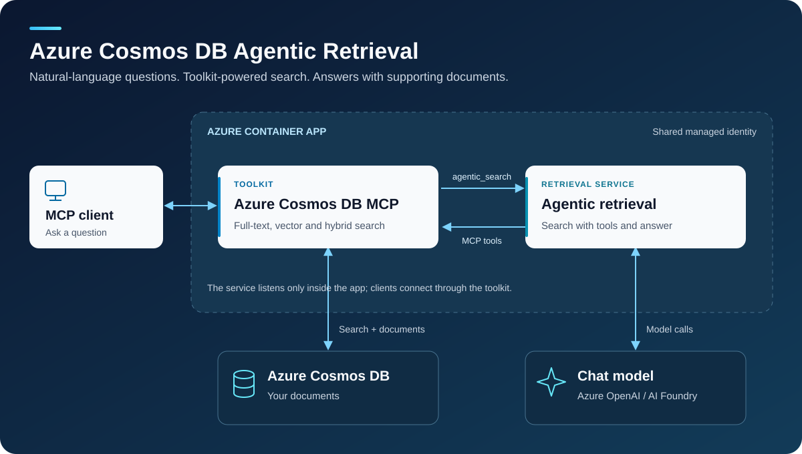

# Azure Cosmos DB Agentic Retrieval (Private Preview)

[Prerequisites](#prerequisites) |
[Quick Start](#quick-start) |
[Configuration](#updating-the-configuration) |
[Limitations](#limitations) |
[Local Testing](#run-locally-for-testing) |
[Benchmarks](#benchmarks)

---



This repository provides an agentic-search service for Azure Cosmos DB. It works
with the [Azure Cosmos DB MCP Toolkit](https://github.com/AzureCosmosDB/MCPToolKit),
called "the toolkit" in the rest of this README. Users can ask an agent a
natural-language question; the agent searches with the toolkit's tools and
returns the answer with its supporting documents.

> [!IMPORTANT]
> This feature is exposed as the toolkit's `agentic_search` tool. It is currently
> in private preview; to join, fill in the
> [private preview form](https://forms.cloud.microsoft/r/eMm2ARSxnH).

## Prerequisites

### Required

1. The toolkit, deployed to Azure Container Apps with Entra sign-in.
   `agentic_search` is not in a toolkit release yet: deploy the toolkit's `main`
   branch at commit [`6291283`](https://github.com/AzureCosmosDB/MCPToolKit/commit/6291283)
   or later.
2. A chat model deployment in Azure OpenAI or Azure AI Foundry.
3. Tools: the same as the toolkit's deployment (Azure CLI, PowerShell 7+,
   Docker Desktop installed and running).

### Recommended

The agent searches with the toolkit's full-text, vector and hybrid search. Your cosmos DB
containers need to be set up for the kinds of search you want it to use:

- **Full-text search.** A
  [full-text policy and index](https://learn.microsoft.com/azure/cosmos-db/gen-ai/full-text-search)
  on the searched fields. The toolkit's full-text search finds documents whose
  field contains the given search phrase. It matches words rather than exact
  characters (for example, plurals), but doesn't rank the results. The
  full-text index makes finding them fast; without it, the search still runs
  but reads every document, using more RUs and taking longer.
- **Vector search.** Stored embeddings, with a
  [vector policy](https://learn.microsoft.com/azure/cosmos-db/vector-search)
  on the embedding field, and preferably a vector index. The toolkit must be
  configured with the embedding model that produced the embeddings
  (`OPENAI_ENDPOINT` and `OPENAI_EMBEDDING_DEPLOYMENT`).
- **[Hybrid search](https://learn.microsoft.com/azure/cosmos-db/gen-ai/hybrid-search).**
  Both of the above. Hybrid search ranks documents by combining vector
  similarity with a BM25 keyword score, which needs the full-text index.

## Quick Start

### Step 1: Get the code

```powershell
git clone https://github.com/Azure/cosmos-agentic-retrieval.git
cd cosmos-agentic-retrieval
```

### Step 2: Configure

```powershell
Copy-Item config.example.yaml config.deploy.yaml
```

In `config.deploy.yaml`, fill in the model you want to use for agentic search.
Both fields are required:

```yaml
llm_base_url: https://YOUR-ENDPOINT/openai/v1
llm_model: YOUR-MODEL
```

> [!NOTE]
> The service calls the model and the toolkit with the app's managed identity.
> The configuration is built into the service's image; the script refuses a file
> with `llm_api_key`.

### Step 3: Add the service to the toolkit app

Use the resource group and Container App name of an existing toolkit app, and
the resource ID of the Azure OpenAI or Azure AI Foundry resource that
hosts the model:

```powershell
.\scripts\Add-Retriever-To-Toolkit.ps1 -ResourceGroup <rg> -ContainerAppName <app> `
  -ConfigFile .\config.deploy.yaml -ModelResourceId <model-resource-id>
```

To find these values:

- **Resource group and Container App name.** List your Container Apps:
  `az containerapp list --output table`.
- **Model resource ID.** In the Azure portal, open the Azure OpenAI or Azure AI
  Foundry resource and select *JSON View* on its overview page, or run
  `az cognitiveservices account show --name <resource-name> --resource-group <resource-group> --query id --output tsv`.

The script builds the service image with the configuration inside, pushes it to
the existing toolkit's registry, lets the app's managed identity call the model
and the toolkit's MCP tools, adds the service as a second container in the app,
and turns on the toolkit's `agentic_search` tool if it is off. You will need to
run it as an owner of the toolkit's Entra app; whoever deployed the toolkit is
an owner. On networks that block PyPI, add `-PipIndexUrl <mirror>` to install
packages from a mirror.

### Step 4: Try it

Connect an MCP client such as VS Code to the toolkit, as described in the
[toolkit's README](https://github.com/AzureCosmosDB/MCPToolKit#vs-code-configuration),
and ask a question that uses `agentic_search`.

Specify a `database` and, optionally, a `container` to limit the search.
Omit both to let the agent discover where to search.

## Updating the configuration

To change the configuration, edit `config.deploy.yaml` and run the script from
Step 3 again. It builds a new image and replaces the service's container.

## Limitations

- **Read-only.** The service never creates or changes databases, containers,
  indexes, or documents.
- **Shares access control with the toolkit.** Only callers allowed to use
  `agentic_search` through the toolkit reach the service, which listens only
  inside the app. As with the toolkit's other tools, searches use the toolkit's
  Cosmos permissions, not the individual caller's.
- **Works best when items share the searched fields.** Since Cosmos DB doesn't
  enforce a schema, the agent discovers a container's fields from a sample
  of 10 items, and sees only top-level fields. Each search looks at one field:
  items without that field (or, for vector and hybrid search, without an
  embedding) aren't found by that search. 

## Run Locally for Testing

> [!WARNING]
> Running the service on your own machine is for testing and development only,
> not for serving users.

```bash
python -m pip install .
cp config.example.yaml config.local.yaml    # fill in as in Step 2
az login
export COSMOS_RETRIEVER_CONFIG_FILE=./config.local.yaml
export TOOLKIT_APP_ID=YOUR-TOOLKIT-ENTRA-APP-CLIENT-ID
python -m cosmos_agentic_retriever serve
```

The service listens on `http://127.0.0.1:9000`. A toolkit running on the same
machine finds it there by default; see the toolkit's
[local development guide](https://github.com/AzureCosmosDB/MCPToolKit/blob/main/LOCAL_DEVELOPMENT.md).

## Benchmarks

Quality, latency and cost results are in
[tests/benchmarks/benchmarks.md](tests/benchmarks/benchmarks.md). To run the
benchmarks yourself, see [tests/benchmarks](tests/benchmarks/README.md).
